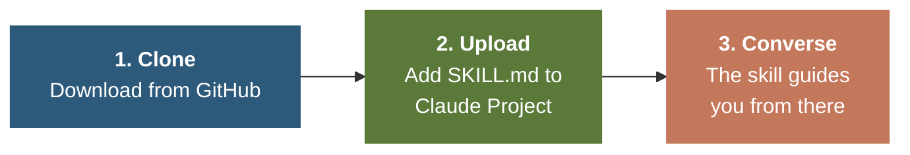
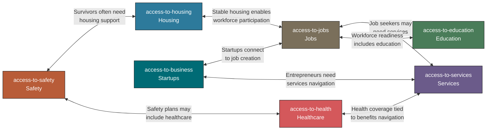
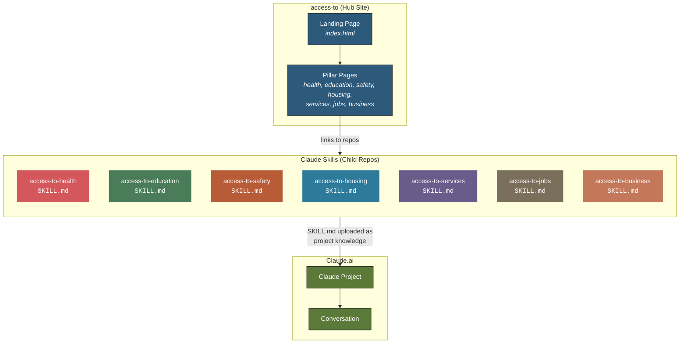
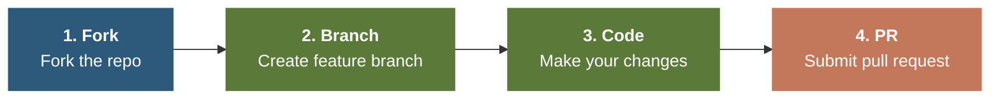
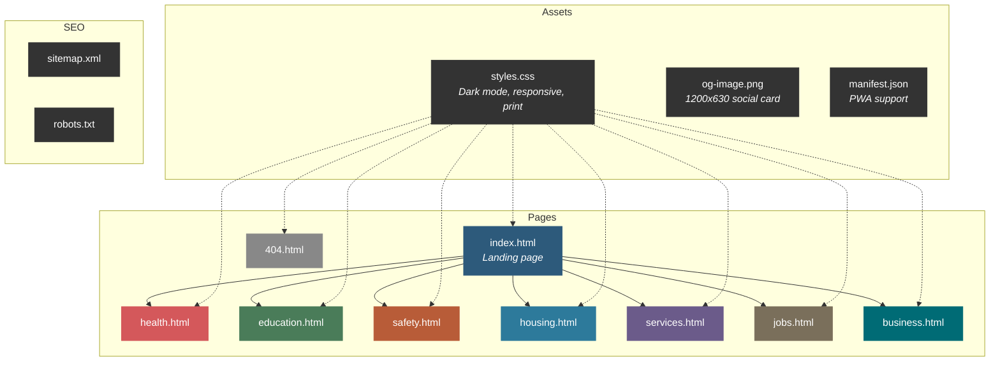

<div align="center">

<!-- HERO BANNER -->
<picture>
  <source media="(prefers-color-scheme: dark)" srcset="https://capsule-render.vercel.app/api?type=waving&color=0:1A1A1A,50:2D5A7B,100:5B7A3A&height=220&section=header&text=Access%20To&fontSize=48&fontColor=FAFAF7&fontAlignY=36&desc=Open-source%20AI%20tools%20closing%20the%20access%20gaps%20that%20matter%20most&descSize=16&descAlignY=56&descColor=CCCCCC&animation=fadeIn">
  
</picture>

[](https://opensource.org/licenses/MIT)
[](https://dougdevitre.org/)
<!-- BEGIN GENERATED:badges -->
[](https://dougdevitre.org/about.html#pillars)
[](https://dougdevitre.org/about.html#pillars)
<!-- END GENERATED:badges -->

**A growing collection of open-source projects organized around the pillars of human access — built for practitioners, advocates, and the people they serve.**

[**View the Live Site**](https://dougdevitre.org/) | [**Browse Projects**](https://dougdevitre.org/about.html#pillars) | [**How It Works**](https://dougdevitre.org/about.html#how-it-works)

</div>

<!-- BEGIN DISCLAIMER: synced from dougdevitre/access-to, edit it there -->
> [!IMPORTANT]
> **Educational information only.** Access To is not legal, medical, mental health, financial or safety advice, and using it creates no professional relationship. **In danger now? Call 911. For crisis support, call or text 988.** Confirm anything important with the official source or a licensed professional. Read the full [disclaimer](DISCLAIMER.md).
<!-- END DISCLAIMER -->

---

## Table of Contents

- [Quick Start](#quick-start)
- [Who Is This For?](#who-is-this-for)
- [Example Scenarios](#example-scenarios)
- [Ecosystem Overview](#ecosystem-overview)
- [The Pillars](#the-pillars)
- [Project Directory](#project-directory)
- [Cross-Project Relationships](#cross-project-relationships)
- [Data Flow Architecture](#data-flow-architecture)
- [FAQ](#faq)
- [Impact at a Glance](#impact-at-a-glance)
- [Contributing](#contributing)
- [Site Architecture](#site-architecture)
- [Support](#support)
- [Built With](#built-with)
- [Contact](#contact)

---

## Quick Start

These projects are **Claude Skills** — structured AI prompt systems that run inside [Claude.ai](https://claude.ai). No coding required.



```bash
# 1. Clone any project
git clone https://github.com/dougdevitre/access-to-health.git
# or: access-to-education, access-to-safety, access-to-housing,
#     access-to-services, access-to-jobs, access-to-business

# 2. Open Claude.ai -> Create a Project -> Upload SKILL.md as project knowledge

# 3. Start a conversation — the skill guides you from there
```

Each skill's `SKILL.md` file teaches Claude a specialized workflow — from navigating healthcare benefits to matching job seekers with WIOA programs across all 114 Missouri counties.

> **Want to see it in action?** A short video walkthrough is coming soon. [Watch this space](https://dougdevitre.org) or [subscribe for updates](mailto:dougdevitre@gmail.com?subject=Access%20To%20Updates).

---

## Who Is This For?

| If you are a... | You might start with... |
|:----------------|:------------------------|
| **Social worker or caseworker** | [access-to-services](https://github.com/dougdevitre/access-to-services) — navigate benefits, programs, and community resources for clients |
| **Educator or curriculum designer** | [access-to-education](https://github.com/dougdevitre/access-to-education) — align lessons to Missouri K-12 standards with AI-powered planning |
| **Domestic violence advocate** | [access-to-safety](https://github.com/dougdevitre/access-to-safety) — safety planning, risk assessment, and crisis resource navigation |
| **Real estate professional** | [access-to-housing](https://github.com/dougdevitre/access-to-housing) — PropTech intelligence with Fair Housing compliance built in |
| **Workforce development staff** | [access-to-jobs](https://github.com/dougdevitre/access-to-jobs) — WIOA navigation and job matching across Missouri |
| **Healthcare navigator** | [access-to-health](https://github.com/dougdevitre/access-to-health) — Medicaid/Medicare guidance and benefits enrollment support |
| **Aspiring entrepreneur** | [access-to-business](https://github.com/dougdevitre/access-to-business) — Missouri startup guide with business launch tools |

Working on justice, peace, civics, community, food, energy, care, or relocation? See the full [Project Directory](#project-directory).

---

## Example Scenarios

These are illustrative examples of how the tools are designed to be used. They are not reports from real users.

> **Workforce caseworker.** A caseworker could use [access-to-jobs](https://github.com/dougdevitre/access-to-jobs) to review a client's options across WIOA training, childcare assistance, and CDL programs in one conversation, then confirm eligibility with each program.

> **Curriculum director.** A K-8 curriculum director could use [access-to-education](https://github.com/dougdevitre/access-to-education) to draft a semester of science lessons aligned to Missouri Learning Standards, with differentiated activities for each grade level to review and adapt.

> **Domestic violence advocate.** An advocate could use [access-to-safety](https://github.com/dougdevitre/access-to-safety) to prepare for a safety-planning conversation: local shelter contacts, protective order steps, and a technology safety checklist to go through with the client.

Each scenario follows the same pattern: clone the repo, upload `SKILL.md` to a Claude Project, and start a conversation. Claude brings structured domain guidance; you bring the context and professional judgment. When working with client information, use de-identified details: no names, addresses, or case numbers.

**Used one of these tools in your work?** [Tell us what worked and what didn't](mailto:dougdevitre@gmail.com?subject=My%20Access%20To%20experience). We publish a story only with your written permission, and we can attribute it by role alone. Please leave out anything that could identify a client.

---

## Ecosystem Overview

`access-to` is the central hub that connects a family of purpose-built tools. Most child repositories are standalone Claude Skills; others are live apps, games, APIs, or frameworks. Every project below is listed in [`.github/config/repos.json`](.github/config/repos.json).

```mermaid
flowchart LR
    HUB["<b>access-to</b><br/>Central Hub & Landing Site<br/><i>dougdevitre.org</i>"]
    subgraph LIVE ["Live and piloting"]
        direction TB
        access_to_food["<b>access-to-food</b><br/>Access to Food"]
        access_to_justice["<b>access-to-justice</b><br/>Access to Justice"]
    end
    HUB --> LIVE
    subgraph BETA ["In beta"]
        direction TB
        access_to_civics["<b>access-to-civics</b><br/>Access to Civics"]
        access_to_crew["<b>access-to-crew</b><br/>Block Crew"]
        access_to_care["<b>access-to-care</b><br/>Care Compass<br/><i>private beta, invite-only</i>"]
        access_to_freedom["<b>access-to-freedom</b><br/>Access to Freedom<br/><i>private beta, invite-only</i>"]
    end
    HUB --> BETA
    subgraph SKILLS ["Claude Skills"]
        direction TB
        access_to_housing["<b>access-to-housing</b><br/>Access to Housing"]
        access_to_jobs["<b>access-to-jobs</b><br/>Access to Jobs"]
        access_to_health["<b>access-to-health</b><br/>Access to Health"]
        access_to_business["<b>access-to-business</b><br/>Access to Business"]
        access_to_services["<b>access-to-services</b><br/>Access to Services"]
        access_to_education["<b>access-to-education</b><br/>Access to Education"]
        access_to_safety["<b>access-to-safety</b><br/>Access to Safety"]
        access_to_peace["<b>access-to-peace</b><br/>Access to Peace"]
        access_to_energy["<b>access-to-energy</b><br/>Access to Energy<br/><i>coming soon</i>"]
        access_for_seniors["<b>access-for-seniors</b><br/>Access for Seniors"]
        access_to_experts["<b>access-to-experts</b><br/>Access to Experts"]
    end
    HUB --> SKILLS
    subgraph DESIGN ["In design"]
        direction TB
        access_to_hr["<b>access-to-hr</b><br/>Access to HR"]
    end
    HUB --> DESIGN

    style HUB fill:#2D5A7B,stroke:#1A1A1A,color:#fff,stroke-width:3px
    style access_to_food fill:#94621F,stroke:#1A1A1A,color:#fff
    style access_to_justice fill:#3E4C6B,stroke:#1A1A1A,color:#fff
    style access_to_civics fill:#8A5A44,stroke:#1A1A1A,color:#fff
    style access_to_crew fill:#4F6F3A,stroke:#1A1A1A,color:#fff
    style access_to_care fill:#7A4E6B,stroke:#1A1A1A,color:#fff
    style access_to_freedom fill:#2F6F6A,stroke:#1A1A1A,color:#fff
    style access_to_housing fill:#2D7A9B,stroke:#1A1A1A,color:#fff
    style access_to_jobs fill:#7A6F5B,stroke:#1A1A1A,color:#fff
    style access_to_health fill:#D4585B,stroke:#1A1A1A,color:#fff
    style access_to_business fill:#006b75,stroke:#1A1A1A,color:#fff
    style access_to_services fill:#6B5B8A,stroke:#1A1A1A,color:#fff
    style access_to_education fill:#4A7C59,stroke:#1A1A1A,color:#fff
    style access_to_safety fill:#B85C38,stroke:#1A1A1A,color:#fff
    style access_to_peace fill:#5B7A8A,stroke:#1A1A1A,color:#fff
    style access_to_energy fill:#876A12,stroke:#1A1A1A,color:#fff
    style access_for_seniors fill:#7A4E6B,stroke:#1A1A1A,color:#fff
    style access_to_experts fill:#006b75,stroke:#1A1A1A,color:#fff
    style access_to_hr fill:#7A6F5B,stroke:#1A1A1A,color:#fff
```

<!-- BEGIN GENERATED:ecosystem -->

<!-- END GENERATED:ecosystem -->

---

## The Pillars

<!-- BEGIN GENERATED:pillars -->
| Pillar | Projects |
|:-------|:---------|
| **Food** | [Access to Food](https://github.com/dougdevitre/access-to-food) |
| **Justice** | [Access to Justice](https://github.com/dougdevitre/access-to-justice) |
| **Civics** | [Access to Civics](https://github.com/dougdevitre/access-to-civics) |
| **Community** | [Block Crew](https://github.com/dougdevitre/access-to-crew) |
| **Care** | Care Compass _(private beta, invite-only)_ · [Access for Seniors](https://github.com/dougdevitre/access-for-seniors) |
| **Mobility** | Access to Freedom _(private beta, invite-only)_ |
| **Housing** | [Access to Housing](https://github.com/dougdevitre/access-to-housing) |
| **Jobs** | [Access to Jobs](https://github.com/dougdevitre/access-to-jobs) · [Access to HR](https://github.com/dougdevitre/access-to-hr) |
| **Health** | [Access to Health](https://github.com/dougdevitre/access-to-health) |
| **Business** | [Access to Business](https://github.com/dougdevitre/access-to-business) · [Access to Experts](https://github.com/dougdevitre/access-to-experts) |
| **Services** | [Access to Services](https://github.com/dougdevitre/access-to-services) |
| **Education** | [Access to Education](https://github.com/dougdevitre/access-to-education) |
| **Safety** | [Access to Safety](https://github.com/dougdevitre/access-to-safety) |
| **Peace** | [Access to Peace](https://github.com/dougdevitre/access-to-peace) |
| **Energy** | Access to Energy _(coming soon)_ |
<!-- END GENERATED:pillars -->

---

## Project Directory

<!-- BEGIN GENERATED:directory -->
| Project | Pillar | Scope | What it does | Status |
|:--------|:-------|:------|:-------------|:-------|
| [access-to-food](https://github.com/dougdevitre/access-to-food) · [live ↗](https://food.cotrackpro.com) | Food | Missouri | St. Louis food access platform: pantry map, distribution events, SNAP guidance, an AI assistant, and volunteer tools |  |
| [access-to-justice](https://github.com/dougdevitre/access-to-justice) · [live ↗](https://dougdevitre.github.io/access-to-justice/) | Justice | Missouri | Civic transparency framework for Missouri family courts: 72 governance-protected metrics, an OSCA binder, and an interactive metric catalog |  |
| [access-to-civics](https://github.com/dougdevitre/access-to-civics) | Civics | Nationwide | Charter: a civic education game for ages 8-14 built on the primary text of all 50 U.S. state constitutions |  |
| [access-to-crew](https://github.com/dougdevitre/access-to-crew) | Community | Missouri | St. Louis civic volunteering backend that turns 311 complaints into cleanup sessions, gated by a Tier-0 volunteer-safety classifier |  |
| access-to-care | Care | Nationwide | Helps a family go from no conversation to a living care plan, designed to be readable by a 10-year-old and a senior with low vision |  Invite-only for now. |
| access-to-freedom | Mobility | Global | Calm, trauma-informed navigator for people planning to move abroad, from first thought to a concrete 12-month plan |  Invite-only for now. |
| [access-to-housing](https://github.com/dougdevitre/access-to-housing) | Housing | Nationwide | PropTech intelligence, market analysis, Fair Housing compliance |  |
| [access-to-jobs](https://github.com/dougdevitre/access-to-jobs) | Jobs | Missouri | WIOA navigation, job matching across 114 Missouri counties |  |
| [access-to-health](https://github.com/dougdevitre/access-to-health) | Health | Nationwide | Healthcare navigation, benefits enrollment, Medicaid/Medicare |  |
| [access-to-business](https://github.com/dougdevitre/access-to-business) | Business | Missouri | Startup guide, entrepreneur support, business launch |  |
| [access-to-services](https://github.com/dougdevitre/access-to-services) | Services | Nationwide | Social services navigation, benefits matching, workforce dev |  |
| [access-to-education](https://github.com/dougdevitre/access-to-education) | Education | Missouri | Standards alignment, lesson planning, teacher growth for Missouri K-12 |  |
| [access-to-safety](https://github.com/dougdevitre/access-to-safety) | Safety | Nationwide | Safety planning, risk assessment, protective orders, crisis resources |  |
| [access-to-peace](https://github.com/dougdevitre/access-to-peace) | Peace | Nationwide | Trauma-informed conflict resolution, mediation, co-parenting de-escalation, and restorative practice navigation |  |
| access-to-energy | Energy | Missouri | Energy as civic duty: routes residents to conservation, production, and utility-assistance programs across all 114 Missouri counties |  |
| [access-for-seniors](https://github.com/dougdevitre/access-for-seniors) | Care | Nationwide | Senior connection and aging-services navigation: early isolation detection, family connection, and benefits routing |  |
| [access-to-experts](https://github.com/dougdevitre/access-to-experts) | Business | Global | Helps experts write, validate and peer-review playbooks that package their methodology as guided steps |  |
| [access-to-hr](https://github.com/dougdevitre/access-to-hr) | Jobs | Nationwide | Human resources navigation: employment rights, workplace protections, and HR process guidance |  |
<!-- END GENERATED:directory -->

---

## Cross-Project Relationships

The child projects are independent but complementary. A person navigating one access gap often faces others simultaneously.



---

## Data Flow Architecture

Each child project follows the same pattern: a `SKILL.md` file teaches Claude a specialized workflow. The hub site serves as the discovery layer.



---

## FAQ

<details>
<summary><strong>Do I need to know how to code?</strong></summary>
<br>
No. These are Claude Skills — structured prompts that run inside <a href="https://claude.ai">Claude.ai</a>. You clone a repo, upload the <code>SKILL.md</code> file to a Claude Project, and start a conversation. No programming required.
</details>

<details>
<summary><strong>What is a Claude Skill?</strong></summary>
<br>
A Claude Skill is a <code>SKILL.md</code> file that teaches Claude a specialized workflow. It acts as project knowledge inside a Claude Project, guiding Claude to follow domain-specific steps — like generating court-ready documents or navigating WIOA workforce programs.
</details>

<details>
<summary><strong>Does this cost anything?</strong></summary>
<br>
The public tools are free and open source (MIT or Apache 2.0; see each repo's LICENSE). You do need a <a href="https://claude.ai">Claude.ai</a> account (free or paid) to use the skills. A paid Claude Pro plan is recommended for longer conversations and higher usage limits.
</details>

<details>
<summary><strong>Which project should I start with?</strong></summary>
<br>
See the <a href="#who-is-this-for">Who Is This For?</a> section above. Pick the project that matches your role or the access gap you're trying to close. Each project is standalone — you don't need to use them all.
</details>

<details>
<summary><strong>Can I use these outside of Missouri?</strong></summary>
<br>
Some projects are Missouri-specific (access-to-education, access-to-jobs, mo-start) because they reference state standards, WIOA regions, or Missouri county data. Others (access-to-health, access-to-safety, access-to-housing, access-to-services) are designed for nationwide use. Check the Scope column in the <a href="#project-directory">Project Directory</a>.
</details>

<details>
<summary><strong>How do the projects relate to each other?</strong></summary>
<br>
They're independent but complementary. A person navigating one access gap often faces others — a domestic violence survivor may need safety planning, housing support, and healthcare navigation simultaneously. See the <a href="#cross-project-relationships">Cross-Project Relationships</a> diagram for how they interconnect.
</details>

---

## Impact at a Glance

<div align="center">

<!-- BEGIN GENERATED:impact -->
| | | | |
|:---:|:---:|:---:|:---:|
| **15** | **18** | **15** | **114** |
| Pillars | Projects | Open-Source Repos | MO Counties Covered |
<!-- END GENERATED:impact -->

</div>

---

## Contributing

Issues, PRs, and feature ideas are welcome.



```bash
git clone https://github.com/dougdevitre/access-to.git
cd access-to
git checkout -b feature/your-idea
# make changes, then...
git push origin feature/your-idea
# open a pull request on GitHub
```

See [CONTRIBUTING.md](CONTRIBUTING.md) for detailed guidelines. For individual project contributions, see each child repo's own guidelines.

This project follows our [Code of Conduct](CODE_OF_CONDUCT.md).

---

## Site Architecture

<details>
<summary>Expand to see the hub site's internal architecture (for contributors)</summary>



### Tech Stack

| Layer | Technology |
|:------|:-----------|
| **Markup** | Semantic HTML5 |
| **Styling** | Vanilla CSS (variables, Grid, Flexbox) |
| **Interactivity** | Vanilla JavaScript (no dependencies) |
| **Fonts** | [DM Serif Display](https://fonts.google.com/specimen/DM+Serif+Display) + [DM Sans](https://fonts.google.com/specimen/DM+Sans) |
| **Badges** | [Shields.io](https://shields.io) |
| **Hosting** | [GitHub Pages](https://pages.github.com) |
| **SEO** | OpenGraph, Twitter Cards, JSON-LD, XML sitemap |

### Features

<table>
<tr>
<td>

**Dark Mode** — system preference detection + manual toggle with localStorage persistence

</td>
<td>

**Responsive** — mobile-first with breakpoints at 500px, 600px, and 700px

</td>
</tr>
<tr>
<td>

**Accessible** — skip-to-content, ARIA labels, keyboard nav, reduced motion support

</td>
<td>

**Fast** — zero JS dependencies, font preloading, lazy-loaded images

</td>
</tr>
<tr>
<td>

**Print-Ready** — dedicated print styles for all pages

</td>
<td>

**PWA-Ready** — web app manifest for installable experience

</td>
</tr>
</table>

</details>

---

## Support

<div align="center">

**These tools are free and open source. Building them isn't.**

[](https://buy.stripe.com/14AcN5gBJ6rRfm07Kz2cg0c)
[](https://venmo.com/u/dougdevitre)

</div>

Your support funds infrastructure, development, and keeping core tools free for families and advocates.

### How funds are used

| Area | What it covers |
|:-----|:---------------|
| **Infrastructure** | Hosting, CI/CD, domains, and services |
| **Development** | New features, security patches, platform stability |
| **Access** | Keeping core tools free for families and advocates |
| **Open Source** | Maintaining the Access To civic tech initiative |

### Sponsor tiers

| Tier | Amount | What you get | |
|:-----|:-------|:-------------|:--|
| **Seed** | $49 | Name in [`SPONSORS.md`](./SPONSORS.md) | [**Sponsor**](https://buy.stripe.com/7sYbJ1719eYngq4d4T2cg03) |
| **Sprout** | $99 | Seed + quarterly project update | [**Sponsor**](https://buy.stripe.com/28EeVdgBJ17x7Ty4yn2cg05) |
| **Supporter** | $149 | Sprout + logo in README | [**Sponsor**](https://buy.stripe.com/bJe5kDbhp3fF2zed4T2cg04) |
| **Advocate** | $250 | Supporter + logo on docs site | [**Sponsor**](https://buy.stripe.com/00wbJ1719cQf7Ty2qf2cg06) |
| **Champion** | $500 | Advocate + early feature access | [**Sponsor**](https://buy.stripe.com/fZu9AT4T1g2rddS7Kz2cg07) |
| **Builder** | $750 | Champion + advisory input | [**Sponsor**](https://buy.stripe.com/28EdR94T19E36Pu9SH2cg08) |
| **Partner** | $1,000 | Builder + dedicated support channel | [**Sponsor**](https://buy.stripe.com/14AeVdfxF8zZfm03uj2cg09) |
| **Sustainer** | $2,500 | Partner + co-branded case study | [**Sponsor**](https://buy.stripe.com/fZu28radleYn3Difd12cg0a) |
| **Visionary** | $5,000 | Sustainer + founding sponsor recognition | [**Sponsor**](https://buy.stripe.com/4gM00jetBeYnddS6Gv2cg0b) |

<div align="center">

*Want to sponsor via invoice, grant, or partnership? Contact [dougdevitre@gmail.com](mailto:dougdevitre@gmail.com).*

See our [current sponsors](./SPONSORS.md).

</div>

---

## Contact

<div align="center">

**Doug Devitre** — product builder, speaker, and founder of [CoTrackPro](https://cotrackpro.com)

Based in the St. Louis metro area. Focused on family law technology, workforce development, and civic access tools for Missouri and beyond.

[](https://linkedin.com/in/dougdevitre)
[](https://github.com/dougdevitre)
[](mailto:dougdevitre@gmail.com)

</div>

---

## Built With

<div align="center">

[](https://claude.ai)
[](https://pages.github.com)

Every Access To project runs as a [Claude Skill](https://claude.ai) — structured AI prompts that turn Claude into a domain-specific assistant. No API keys, no backends, no infrastructure to maintain.

</div>

---

<div align="center">

Open source under [MIT](https://opensource.org/licenses/MIT) unless otherwise noted in individual project repositories.

&copy; 2026 Doug Devitre

<picture>
  <source media="(prefers-color-scheme: dark)" srcset="https://capsule-render.vercel.app/api?type=waving&color=0:1A1A1A,50:2D5A7B,100:5B7A3A&height=100&section=footer">
  
</picture>

</div>
